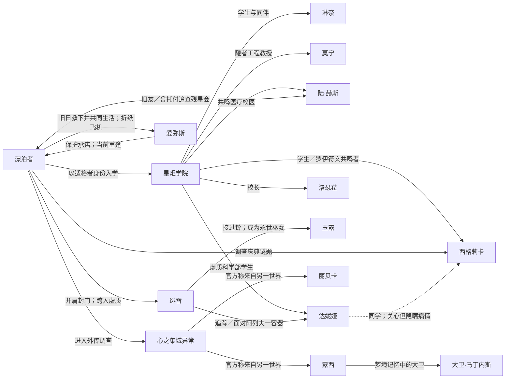

# 鸣潮 3.0–3.4 剧情考据报告：拉海洛篇

整理日与统一访问日：**2026-10-04**。中文，完整剧透。版本日期按官方服务器时间 UTC+8。资料索引：[3.0–3.4资料索引](3.0-3.4资料索引.md)；全库入口：[README](README.md)。

本报告以库街区剧情页为主来源，用官方公告确认章节、任务类型、版本开放日与官方梗概；公开实机录像只作为待核证据。13 篇核心文本的 Wiki 可见正文均已逐篇读完，3.1–3.4正文页显示的任务步骤、对白选择、回忆与后日谈均纳入回顾；这属于 B，不等于实机逐句校验。录像暂未实际核看，没有任何 K 状态或自造时间码。复审补读了四名角色的故事、报告、珍贵之物，以及两名角色全部个性语音；其他人物子项、非核心支线、活动和世界文本尚有缺项，详见[索引](3.0-3.4资料索引.md#范围和状态)。

文中用【事实】表示页面或公告明说的内容，用【角色说法】表示人物陈述，用【推论】表示跨材料分析，用【未解】表示现有材料不足以决定的问题。正文已读也不等于官译、游戏演出或对白分支都经过实机认证。

## 一、版本回顾与主线脉络

官方第三章名为「驶向尚未点亮之星」。3.0以异常频率流失、二十年前的旧学生证和拉海洛的“归来”叙述开篇；章节舞台由罗伊冰原下的地下绿洲拉海洛，扩展到3.1冰原地表，再深入3.3的黯原。剧情持续把漂泊者的失忆与拉海洛的旧计划并置，但两条线是否有同一因果，现有已读内容还不能断言。[官方3.0说明](https://www.taptap.cn/moment/752979031825058423)；[LH-O30](3.0-3.4资料索引.md#LH-O30)

| 版本 | 官方开放的核心文本 | 推进作用与本轮覆盖 |
|---|---|---|
| 3.0（2025-12-25） | 序幕《未知的既感》、第一幕《冰原下的星炬》、第二幕《致第二次日出》 | 漂泊者抵达星炬学院，认识琳奈、莫宁与罗伊人；正文 B。第二幕于2026-01-15开放。 |
| 3.1（2026-02-05） | 第三幕《远航星》、幕间《日光落处》 | 爱弥斯的过去与残存频率、漂泊者旧行踪、陆·赫斯潜入残星会的情报彼此交叉；正文 B。 |
| 3.2（2026-03-19） | 第四幕《影下不落的黄金》、幕间《影面颠倒的兔影》 | 学院暗面把学生被压住的情绪显影；西格莉卡与洛瑟菈各自面对期待与虚无诱惑；正文 B。 |
| 3.3（2026-04-30） | 幕间《愿系铃中》、第五幕《昨夜群星》、幕间《愿系铃中·续》《在熔解的夜空下》 | 绯雪成为永世巫女、隧者放逐阿列夫一并以「拉海洛」之名守门，战后达妮娅离开学院寻求自主结局；正文 B。 |
| 3.4（2026-06-08） | 异闻任务外传《边缘幻梦》、幕间《我们选择天空》 | 联动外传以心之集域接入露西的梦；主线后日篇回应适格者计划在隧者离开后的去向；正文 B。 |

官方给出的次序是玩家接取顺序，不保证每个回忆、梦境或支线都按故事实际时间排列。《边缘幻梦》还有提前体验功能，官方同时建议在《在熔解的夜空下》之后体验；因此其“解锁时间”和剧情建议顺序本就不同。[官方3.4说明](https://www.taptap.cn/moment/812806954857530196)

## 二、实际发生与玩家获知：双时间线

下列“实际发生”按现有证据能确定的相对次序排列，不强行换算成年份。回忆和角色自述保留其来源属性；空间站影像等存在歧义的材料不会被强行安置进确定年表。

| 故事内的相对时间（实际发生） | 玩家获知顺序与证据限制 |
|---|---|
| **更早以前：**拉海洛有星炬学院、深空联合和罗伊人围绕隧者展开的项目；换日仪式和日轮等内容承载旧计划。能够确认的是这些机制早于当前学年与漂泊者抵达。 | **3.0序幕：**玩家先通过黑海岸行动、单向空间通路和旧学生证得知漂泊者将以适格者身份前往星炬学院。官方也以“二十年前的旧学生证”和“归来”提示既往关联；这还不足以恢复漂泊者的完整旧身份。[LH-S30P·E01–E04](3.0-3.4资料索引.md#LH-S30P) |
| **此前某时：**千咲在时间错位中离开家人多年。她本人经历的时间与父母经历的时间并不一致，但她最终回到仍在世的家人身边。漂泊者的旧档案、留失的频率和旧学生证也显示既往经历没有全部随当前记忆保留。 | **3.0第一幕：**玩家在报到后才听见千咲一家的时间差，并从陆·赫斯与学院档案里看到漂泊者记录的异常。哪些旧事发生在同一时期、漂泊者是否曾经在拉海洛生活，尚无足够证据。[LH-S30A·E02–E03](3.0-3.4资料索引.md#LH-S30A) |
| **当前学年，3.0：**琳奈的身份与残星会任务发生冲突；学院项目受到虚质频率干扰。莫宁和同伴推动 Helios 换日计划，在外部危机中完成发射并迎来第二次日出。 | **3.0第一、二幕：**玩家先看到校园日常、再追到有人利用频率装置干扰学院和计划；莫宁的个人经历与技术工作在发射倒计时中交汇。实际是谁在更高层安排所有残星会行动、旧学生证从何而来，仍需后续文本或实机回看。[LH-S30A·E04–E06](3.0-3.4资料索引.md#LH-S30A)、[LH-S30B·E01–E06](3.0-3.4资料索引.md#LH-S30B) |
| **3.1，冰原及旧事：**爱弥斯幼年时在虚质风暴中失去双亲，落水时被穿入旧时空的当前漂泊者救起，随后与旧日漂泊者共同生活；旧日漂泊者离开拯救世界后，爱弥斯立誓保护他。十余年前她擅自与隧者同步、牺牲身体封住阿列夫一。更晚的拉海洛旧任务中，漂泊者把陆·赫斯留下追查残星会；部分旧影像的具体时间仍不能断定。 | **3.1第三幕及幕间：**玩家先经历冰原机兵袭击和爱弥斯重现，后经爱弥斯回忆、空间站影像及赫斯自述，获知此前多段往事。《日光落处》再补赫斯关于父亲、残星会与被挟持学生的调查。[LH-S31A·E06–E10](3.0-3.4资料索引.md#LH-S31A)、[LH-S31M·E01–E08](3.0-3.4资料索引.md#LH-S31M) |
| **3.2，庆典及暗面调查：**异质频率侵入由学生情绪形成的学院暗面，残星会利用焦虑把学生困住；西格莉卡面对自己对失败和期待的恐惧。后续洛瑟菈遭记忆试验，达妮娅与纳波承认学院暗面被轻微改动，用于测试记忆共鸣者和学院防御。 | **3.2第四幕、幕间：**玩家先和西格莉卡共同解谜，再通过洛瑟菈的记忆、塞维的经历与兔子实验获知会长的下一项赌局。绯雪此时仅以巫女身份介入，身份和玉露往事到3.3再展开。[LH-S32A·E01–E08](3.0-3.4资料索引.md#LH-S32A)、[LH-S32M·E01–E08](3.0-3.4资料索引.md#LH-S32M) |
| **3.3，黯原危机前后：**绯雪回穗波面对往人和玉露遗愿，成为永世巫女；其故乡浮岛随后消失。阿列夫一迫近，隧者将其放逐并留下守门；爱弥斯随漂泊者回到学院。战后达妮娅因实验造成的频率衰竭离校前往黯原，结局未明。 | **3.3发布与叙述顺序：**《愿系铃中》先于主线；《愿系铃中·续》接在隧者战后；《在熔解的夜空下》在达妮娅醒来、过生日和离开学院间呈现她的病情与选择。主线通过旧录音带和爱弥斯回归解开纸飞机的部分关系线。[LH-S33M1](3.0-3.4资料索引.md#LH-S33M1)、[LH-S33A](3.0-3.4资料索引.md#LH-S33A)、[LH-S33M2](3.0-3.4资料索引.md#LH-S33M2)、[LH-S33M3](3.0-3.4资料索引.md#LH-S33M3) |
| **3.4，战后：**洛瑟菈曾批准过载试验，适格者艾米娅在载人测试中死亡；旧失败材料后来帮助今州的溯洄雨防护。学院最终保留拉贝尔学部，探索以外源性共鸣驱动载具、向天空寻找新路。外传中露西返回原世界，心之集域经历只留下模糊梦感。 | **玩家体验顺序：**正常解锁建议先做《在熔解的夜空下》，再做《边缘幻梦》；也可从3.0第一幕运载栈提前体验。之后《我们选择天空》才开放并以审查会揭示艾米娅旧事和新计划。外传门扉究竟对应何种本体论机制，页面没有充分定义。[LH-S34X·E01–E13](3.0-3.4资料索引.md#LH-S34X)、[LH-S34M·E04–E10](3.0-3.4资料索引.md#LH-S34M) |

## 三、十三篇核心文本逐篇回顾

### 3.0：进校、旧记录与第二次日出

#### 《未知的既感》——序幕

【事实】黑海岸发现虚质磁暴不稳、漂泊者频率异常，遂准备经单向空间通路将漂泊者送往拉海洛。行动借用了早已存在的星炬学院录取材料，漂泊者以新生／适格者身份入学。守岸人和千咲参与送行，千咲先行前往。开场因此同时设置了现实任务和旧身份疑问：眼前是一次新的远行，入学材料却不是刚刚生成的。[LH-S30P·E01–E03](3.0-3.4资料索引.md#LH-S30P)

【事实】漂泊者抵达后遭遇虚质威胁，随后遇到琳奈并前往星炬学院。千咲与家人重逢揭示时间错位：她的主观离家时间与父母等待的多年相差甚远；团聚是真实的，失去的相处时间却不会因此消失。[LH-S30P·E04](3.0-3.4资料索引.md#LH-S30P)

【未解】旧学生证、漂泊者过去的记录和被遗忘经历互相呼应，但序幕没有给出一份足以确认“漂泊者此前就是某个已知人物”的证明。对照黑海岸先前任务时，应补原任务的直接证据，不能用主题相似代替因果。

#### 《冰原下的星炬》——第一幕

【事实】漂泊者以学生身份融入学院；琳奈起初以张扬、热情的学生形象行动，千咲继续适应时间跳跃后的生活。陆·赫斯检查漂泊者的频率，也把“以前见过漂泊者”的熟悉感带进对话。学院腰带记录身份、频率等个人信息，漂泊者的档案和旧记录之间出现异常。[LH-S30A·E01–E03](3.0-3.4资料索引.md#LH-S30A)

【事实】莫宁等人研究“换日”计划：以隧者相关力量为基础，试图让拉海洛迎来新的日出。隧者与深埋威胁、Helios 计划和学院使用的技术彼此关联，但项目记录有缺漏，风险预测也并非全然乐观。[LH-S30A·E04](3.0-3.4资料索引.md#LH-S30A)

【事实】琳奈受残星会差遣，曾借用他人身份进入学院；她原先希望暂时过普通学生生活，最后却主动保护她已认同的师生。学院没有把她的防卫行动简单抹成无罪：她受到处置，同时得到用真实身份重新争取入学资格的机会。这里的转折是从被组织驱使，到自己决定为什么留下。[LH-S30A·E05–E06](3.0-3.4资料索引.md#LH-S30A)

【未解】文本还保留了旧身份的空记录、陆·赫斯的熟悉感和战后露出的下一层阴影。它们能够支持“这次入学不是完全没有前因”，不能单独证明漂泊者、旧学生或某条组织指令的完整关系。

#### 《致第二次日出》——第二幕

【事实】琳奈通过新的入学考验后，莫宁和学院继续推进 Helios。漂泊者在日轮相关异常中听见不明讯息、产生与旧记忆相连的反应；这段经验首先是漂泊者自己的感受，不能写成莫宁也直接听见同一声音。[LH-S30B·E01](3.0-3.4资料索引.md#LH-S30B)

【事实】罗伊人的日灵、归原仪式和深埋装置将地方信仰与可观测的频率现象连接起来。莫宁与漂泊者调查被人为制造的虚质磁暴，了解它怎样干扰探测和 Helios 的判断；少年的行动和隐瞒也牵涉对日灵的保护，而不只是抽象的“破坏研究”。[LH-S30B·E02–E03](3.0-3.4资料索引.md#LH-S30B)

【事实】莫宁承担实验决策和紧急处置。她的工程能力、人造双腿、对星空的兴趣和私人记忆并非彼此无关：故事把她要求自己冷静可靠的职业身份，放进可能失败、必须由人承担后果的发射现场。最终 Helios 发射并迎来第二次日出；成功解决眼前阶段，不等于外部操纵者和虚质威胁已经全部清除。[LH-S30B·E04–E06](3.0-3.4资料索引.md#LH-S30B)

### 3.1：走向冰原与查访残星会

#### 《远航星》——第三幕

【事实】冰原上的袭击使漂泊者的频率流失再次加重。由于隧者核心与漂泊者相连，爱弥斯以电子幽灵形态出现；其他人看不见她。爱弥斯说明自己在十多年前的一次危机中擅自超频，与隧者同步，短暂唤醒隧者并再次封住阿列夫一，代价是身体被毁。之后她循着回忆和频率残留追寻“存在”，日灵协助她留下痕迹；她曾以“飞行雪绒”的身份唱歌。[LH-S31A·E01–E04](3.0-3.4资料索引.md#LH-S31A)

【角色说法】袭击者辛吉勒姆是以隧者为基础、受阿列夫一污染的机兵，并夺走爱弥斯的力量。爱弥斯认为只要自己和隧者都还存在，她就能击败辛吉勒姆。这个判断由她本人提出，不等于对机兵全部制造史的全知说明。[LH-S31A·E04](3.0-3.4资料索引.md#LH-S31A)

【事实】陆·赫斯确认漂泊者过去曾在拉海洛行动、与隧者有关联，并曾把他留在当地追踪残星会。空间站残片保存着漂泊者坠入“天空海”和溯洄雨的影像；漂泊者自己也不确定影像属于旧日的自己，还是被重放的事件，故不能把它写成已证实的旧时间线。赫斯称自己与旧漂泊者是朋友但不算亲近，受托留在此地很久；他觉得眼前的漂泊者更乐观、更快乐。[LH-S31A·E06–E07](3.0-3.4资料索引.md#LH-S31A)

【回忆】爱弥斯小时候父母在虚质风暴后失踪，她先把幼年落水获救与旧日漂泊者联系起来，两人曾在小屋共同生活一段时间；末尾漂泊者穿入旧时空，才意识到当时向上托起孩子的是当前的自己。漂泊者教她折纸飞机；离开去拯救世界时，她答应保护漂泊者。这足以支持亲密、近似家人的关系，但正文没有给出正式收养关系。[LH-S31A·E08](3.0-3.4资料索引.md#LH-S31A)

【结尾与未解】隧者核心被送回隧者后，爱弥斯随门扉消失，只留下与遗失护身符相连的无声频率残片。漂泊者立誓寻找她，同时明确承认自己不知道她是否仍活着、时间过去多久、频率联结理论是否成立。3.3主线后来确认爱弥斯回到学院，因此“她是否找回”已解决；3.1这一幕本身仍以不确定收束。[LH-S31A·E09–E10](3.0-3.4资料索引.md#LH-S31A)、[LH-S33A·E08–E09](3.0-3.4资料索引.md#LH-S33A)

#### 《日光落处》——幕间·潮汐续闻

【角色说法】赫斯在校医室讲述父亲研发“黄金血／日髓”进化药的经历。试验对象大量死亡；赫斯存活并成为共鸣者，但长期疼痛且色觉受损。无血缘的弟弟莱伊和医生家族也牵涉这段过去。父亲的坟墓是空的，赫斯认为残星会首领曾借用其父身份；这些是赫斯调查所得和个人判断，证据包括一支无法读懂文字的钢笔。[LH-S31M·E01–E03](3.0-3.4资料索引.md#LH-S31M)

【情报，不作全知叙述】赫斯称残星会并非组织严密的单一集团，海德拉负责改造与进化研究，常与塞壬共同行动；新联邦的“厄里斯”是资金与高层枢纽。首领长期借用他人身份、传说和死者记忆。赫斯在坠剑湖密室展示多年调查所得；回忆中的两年潜伏归档发生在受邀赴拉海洛之前；他也向洛瑟菈解释漂泊者过去把他安置在拉海洛的任务，以及自己为何逐渐在意星炬学院。[LH-S31M·E04–E06](3.0-3.4资料索引.md#LH-S31M)

【事实】被绑走的学生是娜波摩。被拘押的残星会成员魏尔伦将他挟持至坠落空间站，赫斯追踪前往；页面结尾聚焦雪地同行时赫斯与漂泊者谈及阿列夫一、往日记忆和糖果，不能把这个页面的结尾写成绑架事件已完全解决。[LH-S31M·E07–E08](3.0-3.4资料索引.md#LH-S31M)

### 3.2：学院庆典、暗面与奇怪的兔子

#### 《影下不落的黄金》——第四幕

【事实】学院暗面是全体学生情绪共同形成的声骸域，作为学院不可分割的影子映照他们真实的情绪，包括焦虑与悲伤。研究所将它收容为换日庆典谜题，希望学生在安全环境中释放积压情绪。庆典期间混入的异质频率与声音诱导学生离开、停止思考，并利用痛苦情绪把人困在暗面。[LH-S32A·E01–E03](3.0-3.4资料索引.md#LH-S32A)

【事实】西格莉卡是未来的秘仪日座，能力出众，却把责任和周围人的期待内化为“绝不能失败”。她帮助漂泊者解读罗伊符文和谜题，同时也是操纵目标；暗面中出现的老师、母亲、朋友形象呈现的是她对他人期待的恐惧，不能当作这些人物的真实评价。她最终承认害怕失败，决定按自己的选择承担期待，击败由其焦虑形成的涡心。她不是有意制造危机的幕后者。[LH-S32A·E04–E07](3.0-3.4资料索引.md#LH-S32A)

【保留歧义】西格莉卡在暗面提及黑猫和看不见的幽灵女孩；后者可能令人联想到爱弥斯，但篇内没有明确确认身份。庆典结束后多数涡心被清除、校方恢复自由出入；这没有终结残星会会长预告的后续“游戏”。[LH-S32A·E05、E08](3.0-3.4资料索引.md#LH-S32A)

#### 《影面颠倒的兔影》——幕间·潮汐续闻

【机制与调查】洛瑟菈先调整漂泊者保留的学生证记忆。她是记忆系共鸣者，能读取、解析、储存或删除附着在物件上的频率记忆，删除后无法恢复，这不只是普通遗忘。研究者塞维教授曾在暗面被兔子改变并隐瞒了恐惧：他担忧研究停滞、渴望答案，甚至一度想以一切换取真相，但最终不愿让学生承受危险代价。[LH-S32M·E01–E03](3.0-3.4资料索引.md#LH-S32M)

【事实】残星会利用记忆共鸣者的弱点诱捕洛瑟菈，暗面电影扭曲重放她的人生选择，使她怀疑自己和学院是否有意义。她拒绝把文明努力归为虚无，提出文明的重量也由见证这些努力的人承载。绯雪以巫女身份出现并帮助她；篇内尚未完整公开绯雪的身份背景。[LH-S32M·E04–E05](3.0-3.4资料索引.md#LH-S32M)

【伏笔】洛瑟菈抓住兔子得知它隶属残星会。会长把赌注从个人命运扩大到拉海洛的存亡，称接下来要测试拉海洛能否继续燃烧。隐藏后日谈中达妮娅承认曾轻微改动暗面，意在帮助西格莉卡面对自己；纳波则透露这也是测试记忆共鸣者抵抗“祂”以及学院防御的实验。洛瑟菈邀请绯雪留在学院；会长称她是“愿望成真巫女”，并称其为最终计划的一环，意图仍待后续剧情解释。[LH-S32M·E06–E08](3.0-3.4资料索引.md#LH-S32M)

### 3.3：绯雪的未竟之事、隧者深入虚质与战后

#### 《愿系铃中》——幕间

【事实】洛瑟菈让绯雪赴穗波，寻找玉露并完成未竟之事。当地往人是已被抹去的芦原居民留下的存在；他们对巫女未能拯救自己怀有怨怼。小女孩甘娜等待巫女救回失踪的姐姐，绯雪将她的等待重新说成已经完成的使命，并承诺姐妹会重逢——这是绯雪给予的希望，不是正文已经展示的现实团聚。[LH-S33M1·E01–E03](3.0-3.4资料索引.md#LH-S33M1)

【角色说法】残星会会长称玉露之死并非自己所为。玉露曾一再动用“铃”预取未来回应愿望，把自己的心愿和未来耗尽；她也留下“不再有下一任樱花巫女”的愿望。绯雪对玉露选择的怨与理解并存，尤其遗憾两人没能一起吃红豆布丁。会长邀绯雪见证记忆，篇末以绯雪接受邀请收束，结局留待续篇。[LH-S33M1·E04–E06](3.0-3.4资料索引.md#LH-S33M1)

#### 《昨夜群星》——第五幕

【局势】阿列夫一威胁迫近，深空联合此前仍受审批和投资方制约。查特最终批准重启隧者，但只给漂泊者十分钟个人搜寻时间；主任务还包括为拟制炉芯收集数据。守岸人说明漂泊者与隧者的旧关系，并将隧者闩锚比作门上的锁。莫宁提供爱弥斯的空壳与录音磁带，以尝试追踪她。[LH-S33A·E01–E03](3.0-3.4资料索引.md#LH-S33A)

【机制与人物选择】绯雪以“预求身”调用可能的未来封住黯原裂隙；白鸟协助引导术式。达妮娅失踪并被确认是残星会制造的容器，曾被塑成处理隧者／阿列夫一频率的个体；会长称其为首个接受阿列夫一“恩赐”而获得虚无／黑暗力量的人。绯雪为对抗其影响消耗了作为鸣式共鸣者的未来可能性。她与漂泊者谈到愤怒、罪责、失败和其他人的选择，拒绝把胜利建立在一个人无所不能之上。[LH-S33A·E04–E06](3.0-3.4资料索引.md#LH-S33A)

【结局】日灵并未沿隧者根系返回，而是填补封印；漂泊者进入门后，在错乱时空中追踪回忆和爱弥斯频率后返回。隧者苏醒后将自身称为由众人手制的“人类之心”，它认可文明仍选择向前探索。它没有杀死阿列夫一，而是将其放逐到遥远宇宙、封闭隧门，并留下守门，直到核心耗尽。它为自己选择新名“拉海洛”。隧者把古老系外探测器“眺望者”的信号放进漂泊者的磁带；学院解码出来自九台深空探测器的回响。漂泊者与爱弥斯回到学院，爱弥斯已再次以完整人物参与众人团聚；爱弥斯“是否仍存在”由此得到阶段性回答，但隧者守门的长期代价仍在。[LH-S33A·E07–E09](3.0-3.4资料索引.md#LH-S33A)

【后续伏笔】残星会首领把达妮娅交由他人看管，派克里斯托弗去新联邦送信，并前往弗洛洛；达妮娅的命运和残星会下一步没有在主线中解决。[LH-S33A·E10](3.0-3.4资料索引.md#LH-S33A)

#### 《愿系铃中·续》——幕间

【事实】玉露以往人形态仍然存在，等待绯雪为她祓净。绯雪起初怨她擅自承担一切，后来得知玉露反复预取未来，以至没有留下灰烬；绯雪自愿接下铃与巫女传承，愿以永世巫女的身份终止下一任巫女的产生。玉露承认自己有隐瞒，也接受绯雪的选择。[LH-S33M2·E01–E03](3.0-3.4资料索引.md#LH-S33M2)

【主题与结果】绯雪承认自己模仿漂泊者“拯救他人”的姿态，也羡慕漂泊者有同伴；她后来意识到，同行者各自的失败与协作才让路继续延伸。白鸟飞向自行选择的去处。会长称愿望已经实现，同时说明穗波海上浮岛、绯雪的故乡在一日之内凭空消失；这并非一个简单的安稳团圆结尾。[LH-S33M2·E04–E05](3.0-3.4资料索引.md#LH-S33M2)

#### 《在熔解的夜空下》——幕间

【事实】达妮娅在接受阿列夫一力量实验后苏醒。她的频率系统性衰竭，预计一周内死亡；深空联合将她拘押并考虑移交新联邦作为样本，学院则把她视为曾经的学生。她同意与漂泊者过生日、在校园走动，以自己掌握的情报交换信任。[LH-S33M3·E01–E02](3.0-3.4资料索引.md#LH-S33M3)

【事实】达妮娅向西格莉卡隐瞒病情，做橙子蛋糕并答应下一年再过生日；她也告诉漂泊者，研究员娜斯塔西娅因污染将被迫离开。达妮娅把他人的损失归咎于自己，频率几度失稳。她后来穿着抑制与追踪装置离开学院，前往黯原。绯雪没有强行拦阻，因为留在学院并不能挽救她的身体；达妮娅的结局仍未展示。[LH-S33M3·E03–E05](3.0-3.4资料索引.md#LH-S33M3)

【角色说法】达妮娅说自己看见黑暗，也听人说黑暗是挣扎中的光；她把“坚持下去，故事也许会有好结局”留给漂泊者。这里是她的愿望和托付，不是她已经获救的证据。[LH-S33M3·E06](3.0-3.4资料索引.md#LH-S33M3)

### 3.4：联动外传与学院的下一步

#### 《边缘幻梦》——异闻任务第三章外传

【事实】星炬学院心之集域门扉泄出异常频率，漂泊者和莫宁进入调查，遇见露西与丽贝卡。外传中的露西起初不理解索拉里斯、共鸣和心之集域；随着她的记忆被唤起，夜之城、义体改造、母亲格洛丽亚、亚当·重锤和荒坂塔等经历逐渐进入梦境。露西谈及的原作背景属于游戏内人物叙述；外部原作设定与游戏实际展示仍分别记账。[LH-S34X·E01–E04](3.0-3.4资料索引.md#LH-S34X)

【机制】梦魇将露西的创伤和恐惧塑成公司狗、亚当·重锤等残象；普通攻击受数据流影响难以奏效。幻梦频段能够对冲梦魇频率，收集多段频率后才可校准武器反击。露西的刻印／共鸣痕迹让她能在梦境中影响心智与血肉，不限于常规设备骇入。白色守门人解释大卫是露西梦境的一部分，可以在心之集域里被“找回”；这描述的是梦内投影，不是现实原作人物复活。[LH-S34X·E05–E09](3.0-3.4资料索引.md#LH-S34X)

【结局与边界】丽贝卡鼓励露西正视梦境中的同伴与创伤。露西最终穿过门扉回到自己的世界；她醒来后不记得经历，只留下“做了个好梦”的模糊感觉，记忆淡化被处理为维持世界稳定的一部分。任务没有证明夜之城角色永久穿越或在《鸣潮》现实线复活。页面后段的离别对白与角色频率消散也应按心之集域投影理解。[LH-S34X·E10–E13](3.0-3.4资料索引.md#LH-S34X)

#### 《我们选择天空》——幕间

【危机】隧者与阿列夫一离开拉海洛后，投资方审查拉贝尔学部和适格者计划。校园传闻把“停办学部／让适格者退学”混为一谈；秋水说明真正争点是投资人暂停计划还是保留培养。洛瑟菈向黑海岸寻求独立调查，却不愿把私人交情变成政治施压。秋水最初不信任她，执花学生的请愿使守岸人同意派人审查。[LH-S34M·E01–E03](3.0-3.4资料索引.md#LH-S34M)

【回忆与责任】洛瑟菈的记忆宫殿保存了学生的心愿和她不愿忘却的失败。她回忆自己批准过载试验，导致适格者艾米娅在载人测试中死亡；艾米娅原本想设计一种连接拉海洛天空与大地的运输方式。此前失败试验的材料后来帮助今州开发溯洄雨防护；洛瑟菈由此拒绝只按成功率衡量失败价值。[LH-S34M·E04–E07](3.0-3.4资料索引.md#LH-S34M)

【决议】审查会上，洛瑟菈主张保留计划，以通才教育和失败试验带来的长期公共收益作证。秋水代表黑海岸确认星炬学生对执花队伍的贡献；漂泊者提出，隧者不再是出路时，寻找新出路的人仍是适格者。审查团最后同意保留拉贝尔学部，但培养计划接受审查团指导与审核。洛瑟菈在此基础上公开新的方向：用外源性共鸣操控、隔绝频率干扰的载具，重新向天空探索。董事会最后决定“再次挑战天空”，但新方案的工程结果尚未呈现。[LH-S34M·E08–E10](3.0-3.4资料索引.md#LH-S34M)

## 四、人物关系

下图画出核心剧情正文明确的任职、同伴、师生、旧日关系和跨世界梦境关系。虚线表示关系尚有未解处；梦境投影不等于人物本人永久穿越。

【已读事实】琳奈的残星会身份与她选择保护学院构成直接冲突；她的关系转折由自己的行动推动，并非漂泊者替她决定。[LH-S30A·E05–E06](3.0-3.4资料索引.md#LH-S30A)

【已读事实】莫宁同时是工程师、教授和发射计划负责人；故事并未把她只写成技术说明人。千咲的家庭团聚说明时间位移对本人和留守家人造成不同损失。[LH-S30P·E03](3.0-3.4资料索引.md#LH-S30P)、[LH-S30B·E04–E06](3.0-3.4资料索引.md#LH-S30B)

【已读事实】漂泊者与爱弥斯有童年救援、共同生活与折纸飞机的回忆；与陆·赫斯则是旧友和长期托付关系。绯雪自愿承接玉露遗愿，但代价和故乡消失仍未解决；达妮娅是残星会制造的容器，实验后的病情与离校结局仍悬置。[LH-S31A·E06–E10](3.0-3.4资料索引.md#LH-S31A)、[LH-S31M·E04–E06](3.0-3.4资料索引.md#LH-S31M)、[LH-S33M2·E01–E05](3.0-3.4资料索引.md#LH-S33M2)、[LH-S33M3·E01–E06](3.0-3.4资料索引.md#LH-S33M3)

人物故事、共鸣报告、珍贵之物与语音覆盖账见[LH-C01–LH-C10](3.0-3.4资料索引.md#人物档案子项)。

### 复审补充：人物档案与主线互证

【事实】赫斯的五篇故事补齐了黄金血受试者、医药集团继承人、残星会潜入者和校医之间的相对经历。莱伊是与他没有血缘关系的弟弟；「雪融之后」写赫斯以日髓固锁失控的莱伊及自身，《日光落处》的旧对话则明确说莱伊仍活着。「关于莱伊」语音仍期待他醒来成为画家。因而“没有保护住莱伊”是赫斯的自责，不能据此写成莱伊已经死亡。日髓的副作用、手套与糖纸把长期病痛和照顾他人的习惯连接起来。[LH-C04·E01–E10](3.0-3.4资料索引.md#LH-C04)、[LH-S31M·E08](3.0-3.4资料索引.md#LH-S31M)

【事实】西格莉卡「天赋」区分语义复现与知识理解；「极限」写她面对失控隧群时，关键符文未能响应，先行设置的陷阱才使她脱险。她对失败的恐惧因此有具体经历，而非只有旁人的期待。「言语」回到家门前，让她把疲惫告诉母亲；母亲缝制的包也同时承载关爱和约束。【推论】这组档案支持把3.2主线的转变理解为承认能力边界、学习表达和寻求支持，而非从此不再恐惧。[LH-C05·E01–E09](3.0-3.4资料索引.md#LH-C05)

【事实】达妮娅「礼物」没有确认她是自然出生、人工制造或某个原体的延续，反而保留她对道别记忆的多种怀疑。「荒芜」说明会长选择容器时看重她的空洞感，她获得人类情感后，与阿列夫一的共鸣强度降低；「明昼」补上西格莉卡邀请组队及娜斯塔霞劝她寻找自己的道路。「群魔」进一步说明她阻挡隧锚并非只出于会长命令，也包含对救世主与牺牲逻辑的质疑。[LH-C07·E01–E04](3.0-3.4资料索引.md#LH-C07)

【事实】「谎言」呈现达妮娅收纳阿列夫一最后碎片、重新认识自己的情感，并祝愿朋友；末尾坠落忽然结束，有未具名者叹息。【未解】这补出了主线离别之后的转折线索，但没有交代其准确发生时刻、地点、来者身份或她的完整生命状态。「突破3」称阿列夫一未真正离开，「烦恼」称副作用已减弱；这些可用语音是角色的说法，不直接证明主线中的宇宙放逐失效，也不能据此宣布病情已治愈。[LH-C07·E05、E10](3.0-3.4资料索引.md#LH-C07)

【事实】洛瑟菈的五篇故事以母亲凯尔梅尔留下的材料组织记忆：母亲早年禁止借外物记录隐私，晚年却准备材料帮助她重建记忆；「学院来信」让学校与母亲对她的交友和能力状态持不同判断；「探险笔记」由母亲转述她在罗伊人观测站获救和走出癔症。个性语音再补她因反抗规划加入先行公约、赴拉海洛考察、调入深空联合和学院，最终愿意留下的相对顺序。【推论】她捍卫学生的选择，可与自身被规划的经历对读；不把母亲、学校或她本人任何一方的判断当成全知叙述。[LH-C08·E01–E05、E10](3.0-3.4资料索引.md#LH-C08)

【剧中档案与NPC评语】洛瑟菈、达妮娅的报告记载、修订说明和评语均是游戏原本文本的一部分。它们呈现的是剧中记录者之间的信息差与档案可信度问题。达妮娅报告中，无引号的检验、诊断段落是剧中报告的记载；后续带引号的话是NPC对这份报告的直接质疑。评语追问当初如何归档，并以实际战斗表现反驳报告中的能力说明和“无超频史”记载。因此，可确认的是剧情主动让读者怀疑该报告的可靠性。【推论】报告可能遭到改写，也可能在最初归档时就没有如实记录；现有文字尚不足以决定具体过程、写作者或改写者的身份。[LH-C07·E06](3.0-3.4资料索引.md#LH-C07)

【剧中修订】洛瑟菈报告先记录复现回忆与超频经历有关，随后又根据新联邦及血亲证明删除超频史，并有停止后续测试的说明。这是文本明确展示的剧中档案修订；修订后的“无超频史”属于档案结论，不能直接覆盖原先记载成为全知叙述。【未解】修订依据是否可信、相关方面为何这样处理，需结合剧情继续判断。西格莉卡诊断中低稳定性、一定风险与曲线稳定的措辞另列为诊断疑点，不与前两人的档案修订和NPC质疑混作同一种情况。[LH-C08·E06](3.0-3.4资料索引.md#LH-C08)、[LH-C05·E06](3.0-3.4资料索引.md#LH-C05)

【支线覆盖】《光的来处》任务页确认危行类型与敏娜学习使用终端的开端；《明日摇曳的绯影》任务页确认潮汐类型及《影面颠倒的兔影》前置。两页均只有任务简介，不能据此补写完整结局。任务合集另发现工程、日灵、学院研究、怪谈等遗漏条目，已加入目录覆盖账；版本和对白未核者仍为L。[LH-T02](3.0-3.4资料索引.md#LH-T02)、[LH-T01](3.0-3.4资料索引.md#LH-T01)、[目录补采](3.0-3.4资料索引.md#复审补采任务页与目录遗漏)

## 五、世界观机制与文本边界

| 名词／机制 | 已有证据支持的表述 | 不能超出的结论 |
|---|---|---|
| 拉海洛与罗伊冰原 | 官方称拉海洛位于罗伊冰原下方，是由气候和地极变化塑造的地下区域；3.1将冰原表面、港口、科考与隧群迁徙带入叙事。[LH-O30](3.0-3.4资料索引.md#LH-O30)、[LH-O31](3.0-3.4资料索引.md#LH-O31) | 地区宣传文案不是全套地质史或罗伊人迁居史，不能仅凭简介补成年代。 |
| 适格者、学院腰带与旧学生证 | 3.0正文呈现学院身份记录与漂泊者既往资料异常；官方公告确认二十年前学生证提示和“归来”的悬念。[LH-S30P](3.0-3.4资料索引.md#LH-S30P)、[LH-S30A](3.0-3.4资料索引.md#LH-S30A) | 数据相同不证明人格同一；旧记录空白也可能来自系统损坏或别的原因。 |
| 隧者／隧者计划 | 除作为工程计划对象，3.3正文将它写作有自我判断的守门者：放逐阿列夫一、封闭隧门、留下守候并选择“拉海洛”之名。[LH-S33A·E02–E08](3.0-3.4资料索引.md#LH-S33A) | 核心耗尽的准确时间、门外宇宙环境及它是否能恢复仍未回答。 |
| Helios、换日与日轮 | 3.0正文将换日计划、Helios 和日轮相关异常相连；发射成功带来第二次日出。[LH-S30B](3.0-3.4资料索引.md#LH-S30B) | 不能据一次成功就认为新日照解决了阿列夫一或所有虚质危机。 |
| 虚质、虚质磁暴和频率流失 | 3.0主线与3.1–3.3正文多次呈现虚质影响通信、探测或行动；漂泊者本人也经历频率流失。[LH-S30P](3.0-3.4资料索引.md#LH-S30P)、[LH-S30B](3.0-3.4资料索引.md#LH-S30B)、[LH-S31A](3.0-3.4资料索引.md#LH-S31A)、[LH-S33A](3.0-3.4资料索引.md#LH-S33A) | 不把虚质、悲鸣、鸣式和残星会频率技术当成同义词。因果需逐场景定位。 |
| 爱弥斯“电子幽灵”与频率 | 3.1正文将其身体毁坏、意识／频率附着隧者核心、离门后留有护身符残片分开呈现；3.3主线确认她随漂泊者回到学院。[LH-S31A·E03–E10](3.0-3.4资料索引.md#LH-S31A)、[LH-S33A·E08–E09](3.0-3.4资料索引.md#LH-S33A) | “已回来”解决当下存续问题，不足以说明她的频率与实体机制、生命状态及未来是否完全稳定。 |
| 日灵与归原仪式 | 3.0正文把日灵、罗伊人仪式、遗留频率和人为装置放在同一线索里。[LH-S30B·E02–E03](3.0-3.4资料索引.md#LH-S30B) | 罗伊人的角色解释、传统说法、实验判断要分开；旧文明遗物是否等同于某个人不能凭外形断定。 |
| 学院暗面 | 学生集体情绪声骸域，经研究所收容为庆典谜题；残星会异质频率借痛苦情绪制造涡心。[LH-S32A·E01–E08](3.0-3.4资料索引.md#LH-S32A) | “祂”的本体、暗面实验的长期目的和兔子远程操控者仍不明。 |
| 记忆共鸣与记忆宫殿 | 洛瑟菈能读、存、删物件频率中的记忆，删除不可恢复；她将个人及学生记忆实体化为宫殿展品。[LH-S32M·E01–E05](3.0-3.4资料索引.md#LH-S32M)、[LH-S34M·E04–E07](3.0-3.4资料索引.md#LH-S34M) | 页面展示的是能力和具体记忆，不是可无损回放所有历史的客观数据库。 |
| 心之集域与《边缘幻梦》 | 梦魇、幻梦频段和角色回忆共同构成对露西创伤的梦境演出；她回到本世界后只保留模糊梦感。[LH-S34X·E05–E13](3.0-3.4资料索引.md#LH-S34X) | 游戏内联动不能自动证明外部原作完整设定为本篇宇宙史，也不证明梦中人物在《鸣潮》现实线复活。 |

## 六、跨文本考据与主题

### 身份资料不是身份本身

【事实】旧学生证、漂泊者当前记录异常、陆·赫斯的熟悉感一起构成“过去尚未解释”的证据链，但都没有直接完成身份揭晓。[LH-S30P·E02](3.0-3.4资料索引.md#LH-S30P)、[LH-S30A·E03](3.0-3.4资料索引.md#LH-S30A)

【推论】这个安排让学院入学既是调查结果，也是一个新社会身份的开始。琳奈因盗用他人身份进入学院，后来靠行动争取以真实身份重新入学；漂泊者则是已有旧记录但无法读出完整过去。两人都面对“记录把我说成谁”和“我选择如何行动”的差别，但两者处境与责任并不相同。

### 技术、信仰与人的解释权

【事实】莫宁以工程方法推动换日项目；罗伊人用仪式语言解释日灵与归原；漂泊者接触到旁人没有直接听见的讯息；官方又把学院暗面和虚质空间的异常作为后续悬念。[LH-S30B·E01–E03](3.0-3.4资料索引.md#LH-S30B)、[LH-O32](3.0-3.4资料索引.md#LH-O32)

【推论】故事让多种解释路径共同工作，但不能把仪式话语简单说成迷信，也不能因为出现仪器就认为地方传统已被科学完全解释。关键问题是具体角色能观察到什么、推测了什么、仍不能知道什么。

### 选择与职责：从“被安排”到“决定留下”

【事实】琳奈面对残星会差遣与学院归属；莫宁面对科研风险和要由她承担的实验判断；3.4官方把洛瑟菈置于教师、校长与学院现实存续之间。[LH-S30A·E05–E06](3.0-3.4资料索引.md#LH-S30A)、[LH-S30B·E04–E06](3.0-3.4资料索引.md#LH-S30B)、[LH-O34](3.0-3.4资料索引.md#LH-O34)

【推论】3.0的回答是以行动证明自己愿意保护谁，3.4的难题则是危机过去后仍需为知识机构争取资源。守护并不只等于战斗胜利，也包括让学校和学生拥有继续选择的条件。

### 纸飞机、群星与“找回”的双重含义

【事实】纸飞机是旧日漂泊者教爱弥斯折叠的物件；3.3主线将找回爱弥斯与“眺望者”探测器留下的星海回声并置。前者关乎个人关系的延续，后者让拉海洛确认自己并非孤立文明。[LH-S31A·E08](3.0-3.4资料索引.md#LH-S31A)、[LH-S33A·E07–E09](3.0-3.4资料索引.md#LH-S33A)

【推论】“找回”在这组文本里有不同尺度：找回一个人、找回被遗忘的记忆、找回失败作品的价值、找回文明继续前进的方向。频率残存、人物重逢、计划保留并非同一个结论，报告按对象分别表述。

### 被期待成为英雄，也可以承认害怕

【事实】西格莉卡被期待成为秘仪日座，却在暗面中看见自己对失败的恐惧；绯雪被往人的愿望推到近乎无所不能的位置，最终选择承接巫女责任并拒绝让下一代继续牺牲。两人都没有靠否认害怕来完成选择。[LH-S32A·E04–E07](3.0-3.4资料索引.md#LH-S32A)、[LH-S33M1·E01–E06](3.0-3.4资料索引.md#LH-S33M1)、[LH-S33M2·E01–E05](3.0-3.4资料索引.md#LH-S33M2)

【推论】文本逐步把“承担责任”从单人英雄主义改写为可拒绝、可协作、须讨论代价的选择。漂泊者与绯雪对话中承认失败可能性，学院学生则在校长支持下继续求索；达妮娅的自选离开则提醒读者，不应把他人生命变成集体愿望的工具。[LH-S33A·E05–E06](3.0-3.4资料索引.md#LH-S33A)、[LH-S34M·E08–E10](3.0-3.4资料索引.md#LH-S34M)

### 失败能留下可继承的知识

【事实】洛瑟菈曾因批准过载实验承受艾米娅死亡的责任；另一名失去适格者身份的学生把试验废料带回今州，其思路帮助溯洄雨防护研发。她在审查会上引用这段历史，不把失败美化成胜利，而是反对仅以短期成功率评价探索。[LH-S34M·E04–E10](3.0-3.4资料索引.md#LH-S34M)

【推论】《我们选择天空》把3.0换日成功的庆祝延展为更困难的问题：当原计划的隧者离开后，支持学习和试错是否仍有价值？结尾保留学部但纳入董事会审核，说明理想获得继续生长的空间，也继续受到制度与资源制约。

### 创作访谈补充：情感、角色成长与连续性

**2026-10-07补充；来源层级为创作者访谈。**游戏那点事的采访中，文案负责人鹅鹅鹅将3.1爱弥斯故事的情感中心解释为家庭关系，并强调漂泊者的成长及新故事对旧内容的回看。这为本篇关系主题提供创作背景；访谈也提及旧细节可在后续规划中继续发展，因此文本呼应不能自动证明从初版就已规划好结局。剧情时序、时空机制和3.3重逢仍须分别由游戏文本支持。[LH-INT01·E02、E07、E10](3.0-3.4资料索引.md#LH-INT01)；完整主题与边界见[访谈整理](鸣潮文案负责人访谈整理.md)。本次没有新增实机核验或改变原有缺项状态。

## 七、人物动机、伏笔与未解问题

| 线索 | 已知证据 | 当前判定与下一步 |
|---|---|---|
| 漂泊者的旧学生证、旧行踪与学院记录 | 3.0记录异常；3.1赫斯称旧漂泊者曾派他留在拉海洛追查残星会，空间站影像则可能是旧人经历也可能是重放。[LH-S30P](3.0-3.4资料索引.md#LH-S30P)、[LH-S31A·E06–E07](3.0-3.4资料索引.md#LH-S31A) | 已确认漂泊者过去在拉海洛行动过；未解的是准确时间、影像属性、记忆断层原因和与旧学生证的关系。 |
| 琳奈的真实身份与加入动机 | 3.0已读：冒用学生身份、受残星会差遣、后主动保护学院。[LH-S30A](3.0-3.4资料索引.md#LH-S30A) | 本篇主要抉择已回收；真实琳奈后续去向、组织如何挑中她仍待档案和世界文本。 |
| 莫宁的个人愿望与科研风险 | 3.0第二幕已读；科研、身体经历、个人记忆与发射决策并行。[LH-S30B](3.0-3.4资料索引.md#LH-S30B) | 动机只依当前正文可读部分整理；补采角色故事后再审其与隧者研究的长期关系。 |
| 爱弥斯频率与“存在” | 3.1解释身体毁坏、频率残留与漂泊者旧日关系；3.3主线中她回到学院。[LH-S31A·E03–E10](3.0-3.4资料索引.md#LH-S31A)、[LH-S33A·E08–E09](3.0-3.4资料索引.md#LH-S33A) | 当前重逢已确认；她如何长期维持存在、旧体与残留频率的机制仍未细讲。 |
| 陆·赫斯与残星会 | 赫斯以潜伏调查和父亲身份线索解释残星会结构，娜波摩遭挟持后他追往空间站。[LH-S31M·E01–E08](3.0-3.4资料索引.md#LH-S31M) | 赫斯的情报来源、父亲身份判断及被挟持事件最终处置仍需后续文本和档案互证。 |
| 学院暗面、兔子与残星会的“游戏” | 暗面是学生情绪形成的声骸域；兔子隶属残星会；达妮娅与纳波揭示测试记忆共鸣者及学院防御。[LH-S32A·E01–E08](3.0-3.4资料索引.md#LH-S32A)、[LH-S32M·E06–E08](3.0-3.4资料索引.md#LH-S32M) | “祂”与暗面实验的长期目标、会长真正身份及下一场赌局结果未解。 |
| 绯雪、玉露、穗波居民 | 续篇确认玉露为等待祓净的往人；绯雪继承铃、成为永世巫女，穗波浮岛随后消失。[LH-S33M1·E04–E06](3.0-3.4资料索引.md#LH-S33M1)、[LH-S33M2·E01–E05](3.0-3.4资料索引.md#LH-S33M2) | 个人选择已交代，故乡消失的机制、当地往人去向和绯雪的长期代价仍需世界文本补证。 |
| 阿列夫一与隧者 | 隧者把阿列夫一放逐至遥远宇宙并留守封门；它自称“拉海洛”。[LH-S33A·E07–E09](3.0-3.4资料索引.md#LH-S33A) | 阿列夫一是否能回归、隧者核心耗尽后的世界状态、十分钟搜寻条件背后的完整计划未知。 |
| 达妮娅的病情与自主选择 | 正文确认实验造成频率衰竭，她离开学院赴黯原；角色故事「谎言」另呈现收纳最后碎片后的坠落突然终止和未具名叹息。[LH-C07·E05](3.0-3.4资料索引.md#LH-C07)、[LH-S33M3·E01–E06](3.0-3.4资料索引.md#LH-S33M3) | 结局仍悬置，但新增后续转折线索；不能据叹息确认救援者，也不能把角色可用语音当连续年表。 |
| 学院预算和拉贝尔学部去留 | 审查会保留学部，要求培养计划接受董事会指导；提出共鸣载具和再次探索天空。[LH-S34M·E08–E10](3.0-3.4资料索引.md#LH-S34M) | 学生未来与新载具研发成果未呈现，学部保留也不是完全摆脱资方监督。 |
| 外传的跨世界边界 | 露西穿门返回自己的世界，醒后只留下模糊梦感；丽贝卡与大卫的呈现属于梦境投影。[LH-S34X·E08–E13](3.0-3.4资料索引.md#LH-S34X) | 跨世界频率如何连通未解释；游戏之外的原作设定不自动属于《鸣潮》正篇史实。 |
| 「明日摇曳的绯影」 | 任务页标为潮汐任务，前置《影面颠倒的兔影》，简介涉及礼堂会面与残星会阴谋。[LH-T01](3.0-3.4资料索引.md#LH-T01) | P：仅简介；完整对白、实装日及与「记忆中的绯影」关系仍待核。 |
| 3.5玄方篇的衔接 | 玄方篇官方版本基准记录《山雨欲来风满楼》前置为《我们选择天空》。[玄方索引 O35](资料索引.md#O35) | 已确认章节先后；没有直接证据时不推断拉海洛角色与玄方人物之间存在幕后关系。 |

## 八、覆盖程度与研究限制

13 篇核心文本已逐篇阅读库街区当前可见正文并形成回顾：13 B、0 P、0 L。此状态表示正文页面内容已读，不代表游戏客户端实机对照、画面转场和角色性别版本已校验；录像核验仍为 0 K。正文页中可见的对白选项和回忆已纳入，游戏内不同选项是否有未呈现在 Wiki 的差异尚未逐一录像比对。

支线与活动已有官方名称和部分公开录像候选的目录审计；危行、纪闻、隐藏任务、诸星密语、联动活动、剩余人物档案子项、任务物品、地图文献、NPC 对话、声骸/敌人叙事文本仍有待补项。索引为这些条目逐类写明 N、L 或范围排除原因。缺项只表示本研究尚未完成采集，不表示游戏内容未开放。

本轮补采为四名角色的20篇故事、4份报告、12件珍贵之物、两名角色的62条个性语音及赫斯9条语音。四名角色战斗语音、其余六名角色档案、支线与活动全文、世界文本和实机录像仍待补。核心回顾已覆盖13篇可见文本；补充材料与客户端分支尚非全集，新增目录条目也只记录到明确的采集状态。具体按[缺项清单 LH-D01–LH-D10](3.0-3.4资料索引.md#缺项清单)继续补采。每次采集同时更新本报告、索引和 README；缺项未清时不把本篇标成“全集覆盖完成”。
